# dfukit 2 design

Firmware updates over any link, for any device that can take an image: a small protocol, a
platform-independent core with both ends (the device's server and the host's client), and
backends that put an image in place. dfukit 2 is a new major version: new wire format, new API,
new package.

This document describes the protocol and the library's internals; [README.md](README.md) is the
guide to using it.

## Goals

- One protocol for every link. USB, a WebSocket, BLE, a UART, UDP, a message bus: the protocol
  only needs *frames* going both ways. They need not be reliable, in order or of a fixed size.
- No transport code in the library. How frames travel is the application's business: the core
  takes a frame in and hands frames out. A byte stream needs framing of its own
  around them.
- No platform code in the core. Plain C99: no threads, no RTOS, no heap required, time passed
  in. It runs in an RTOS application, in a bootloader, on bare metal, and on a PC.
- Both ends in C. The core has a *server* (the device's side: sessions, backends) and a
  *client* (the host's side: window, resends, resume). The Python package wraps both: the
  protocol is implemented once, and an embedded host uses the same client.
- Backends per board. What is platform-specific (flash, an OTA API, a bootloader, another
  device) lives in a backend, registered for the board IDs it takes.
- A full pipeline. The host streams; the device answers asynchronously. A lost frame costs a
  resend of part of a window, never a stall.
- No dependencies in the core: plain binary messages (a TLV tail where fields are optional).

## Level 0: roles

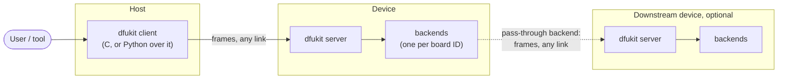

- Host: has the image and sends it (a PC tool, a phone, or an embedded host).
- Device: takes images for the board IDs its backends are registered for.
- Bridge: a device whose backend is a *pass-through*: it carries a session on to a downstream
  device, which checks and writes itself. Chains of bridges work the same way.

## Level 1: the parts

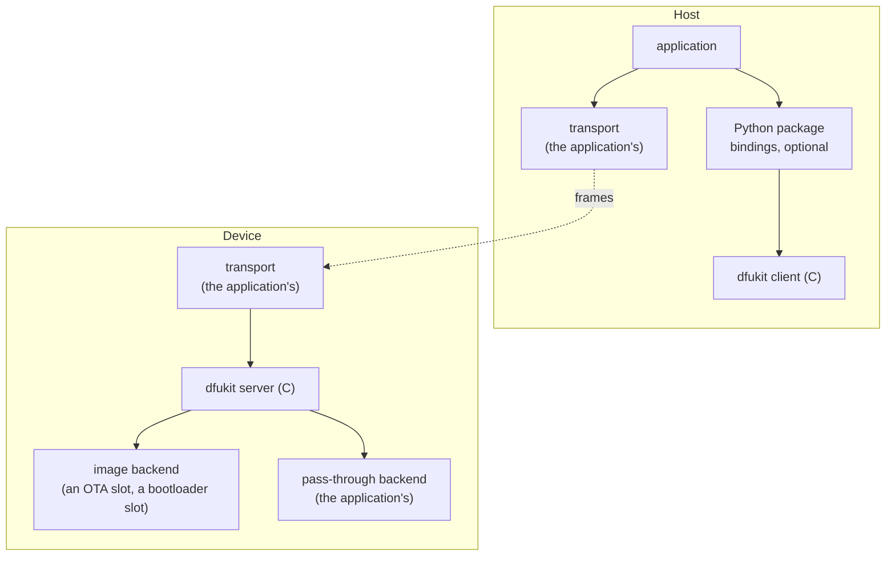

## Level 2: inside the library

The core knows sessions, messages, flow control and timers, and nothing about links or flash.
Backends know nothing about the protocol. On a device, a frame takes this path:

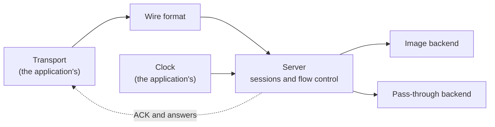

The client is the same core seen from the other end: it builds frames with the same wire format,
keeps the window, resends after a gap or a timeout, and resumes. A host links the client, a device
links the server; a bridge that also sends on its own links both.

- Peer: every frame comes in with an opaque peer address from the transport (a socket, a BLE
  connection, a bus address). Answers go to the frame's own peer; a session belongs to the peer
  that sent its `START`.
- Two kinds of backend. An *image* backend gets the image, in order, and puts it in
  place. A *pass-through* backend gets the session's frames unchanged and hands back the frames of
  the device behind it; the core keeps the owning peer and routes the answers to it. Flow control
  and checks then happen at the far end. dfukit provides the interface; pass-through
  backends are written by the application, since only it knows the downstream link.

## Protocol

### Messages

All integers little-endian. Every frame starts with an opcode byte; host-to-device opcodes are
`0x0N`, the device's answer to one is `0x8N`.

| Op | Name | Host to device | Device to host (`0x8N`) |
|---|---|---|---|
| `01` | `INFO` | (empty) | protocol version `u8`, device name (length `u8` + UTF-8), board count `u8`, then one board record each (see below) |
| `02` | `START` | board ID `u32`, encoding `u8`, flags `u8`, image size `u32`, stream size `u32`, CRC-32 `u32` of the image | status `u8`, session `u16`, resume offset `u32`, window `u32`, max data `u16` |
| `03` | `DATA` | session `u16`, offset `u32` (in the stream), bytes | none (see `ACK`) |
| `83` | `ACK` | (not sent) | session `u16`, status `u8`, offset `u32` (all bytes before it taken), window `u32` (more allowed beyond it) |
| `04` | `FINISH` | session `u16` | status `u8`, reason (length `u8` + UTF-8) |
| `05` | `ACTIVATE` | session `u16`, flags `u8` (now / at next boot), delay `u16` ms | status `u8` |
| `06` | `ABORT` | session `u16` | status `u8` |
| `07` | `STATUS` | (empty) | state `u8`, session `u16`, offset `u32`, board ID `u32` |

A board record in `INFO`: board ID `u32`, backend kind `u8` (image, pass-through), largest image
`u32`, encodings `u8` (a bit per encoding: bit 0 raw), window `u8` (log2 of the largest window an encoding
may use, 0 for raw), then a TLV tail: length `u16`, and entries of type
`u8` + length `u8` + value. Types so far: `1` name (UTF-8), `2` running version (UTF-8). A host
skips types it does not know, so a device can add fields
without breaking older hosts. No serialization library on either end.

`START` flags: bit 0 *resume*. Encodings: `0` raw; a device refuses others with `BAD_FRAME`.

### Status codes

| Code | Meaning | Host does |
|---|---|---|
| `00` | OK | go on |
| `01` | `GAP`: a `DATA` frame past the expected offset; the `ACK`'s offset is where to go on | rewind to it |
| `02` | `BUSY`: another peer owns the session | wait, or give up |
| `03` | `UNKNOWN_BOARD`: no backend registered for `START`'s board ID | give up, nothing touched |
| `04` | `TOO_LARGE` | give up |
| `05` | `NO_RESUME`: no state to resume from (the device restarted) | `START` again from 0 |
| `06` | `BAD_STREAM`: the stream is not the size `START` said | give up |
| `07` | `CRC_MISMATCH` at `FINISH` | give up |
| `08` | `BACKEND`: the backend refused (flash, signature, its own check); the reason has its text | give up |
| `09` | `NO_SESSION`: a session number nobody knows (the device restarted) | give up, or `START` again |
| `0A` | `BAD_FRAME`: a request too short, or an unknown encoding | give up |
| `0B` | `PENDING`: `FINISH`'s answer while the backend is still writing | `FINISH` again |

Unknown opcodes and a `DATA` too short for its header get no answer: a frame that cannot be read
never starts a reply.

### A normal update

The host streams `DATA` without waiting; the device answers with `ACK`s on its own cadence: every
8 KB taken or once half the window is used, whichever is less, and at the latest after 50 ms. The
`INFO` exchange below is optional, and up to the application: the client does not send it.

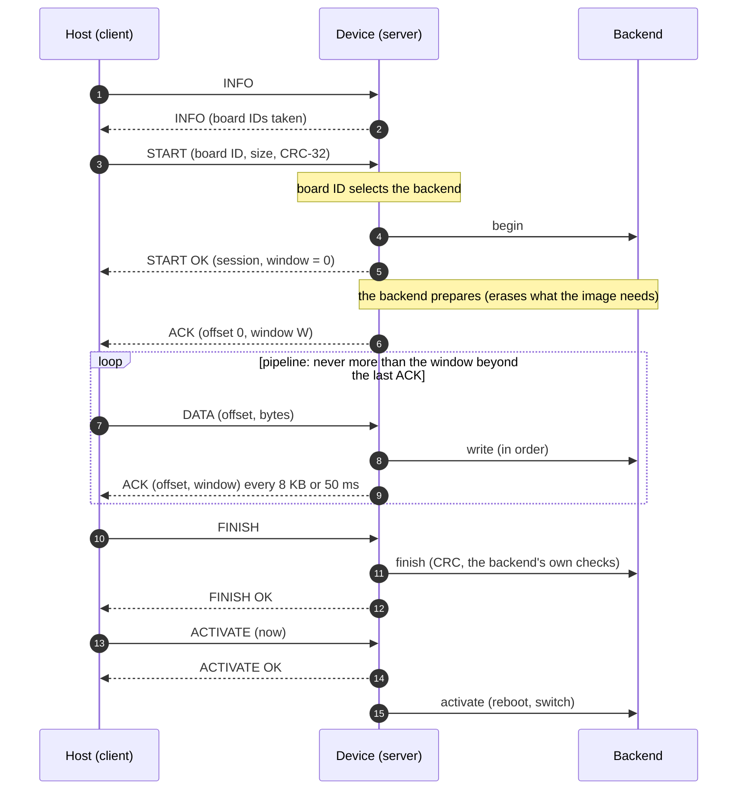

- The board ID selects the backend before anything else happens: no backend for it, no
  session, nothing touched.
- Prepare before the first `ACK`. `START` is answered with window 0; the first `ACK` with room
  comes once the backend is ready. A backend that cannot take data while it erases (a bootloader
  running from the flash it writes) keeps the window at 0 until then.

### Flow control: a credit window

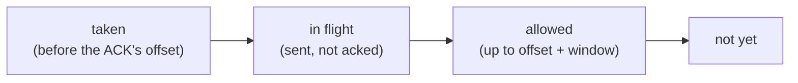

- The window comes from the device, in every `ACK`: at most what it can buffer. It shrinks it
  while busy and grows it again after. A window of 0 means wait: the host probes, and every
  `ACK` tells it the device is still there. When the window opens again the device sends an
  `ACK` of its own.
- The host has at most *offset + window* sent. The server does not enforce this: whether more fits
  is up to the backend.

### Lost frames: go-back-N

The device takes `DATA` only at exactly the expected offset. Anything past it means a frame was
lost: it drops the frame and sends an `ACK` with status `GAP` at once. Anything before it is a
duplicate: ignored, acked again.

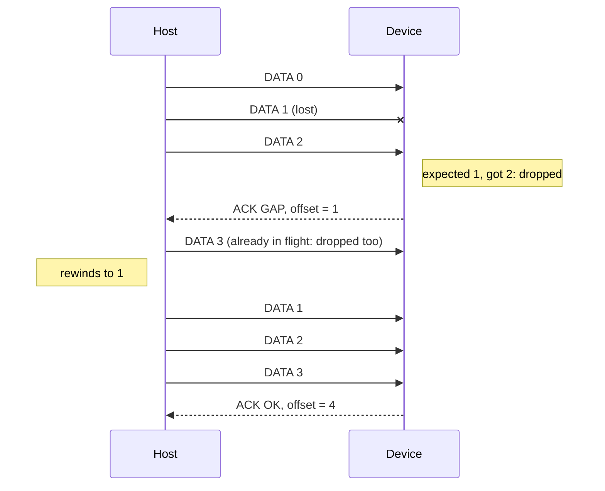

- A lost `ACK` costs nothing: the next one carries the same, later offset.
- Timeout: with no progress for the client's `RTO` (`rto_ms`, 500 ms by default), the host
  sends from the last acked offset again, or a probe (`DATA` of length 0) when nothing is in
  flight. That also covers a lost `GAP`. Requests (`START`, `FINISH`, `ACTIVATE`) are sent
  `tries` times (8) before the client gives up; every answer from the device resets them, and
  `stall_ms` (5 minutes) bounds a device that answers but makes no progress.
- The device never buffers out of order: it writes strictly in sequence. A loss costs
  at most one window resent.

### Resume

A link that breaks mid-transfer leaves the session waiting: suspended after `idle_ms` (10 s)
without a frame, dropped `resume_ms` (60 s) after that. The host connects again, from the same
address or another one, and sends `START` with the *resume* flag and the same image: the host gets
the session back at the point it reached, even if the whole image had already arrived (it then
sends `FINISH`). The image's CRC and sizes name the session; there is no other credential.

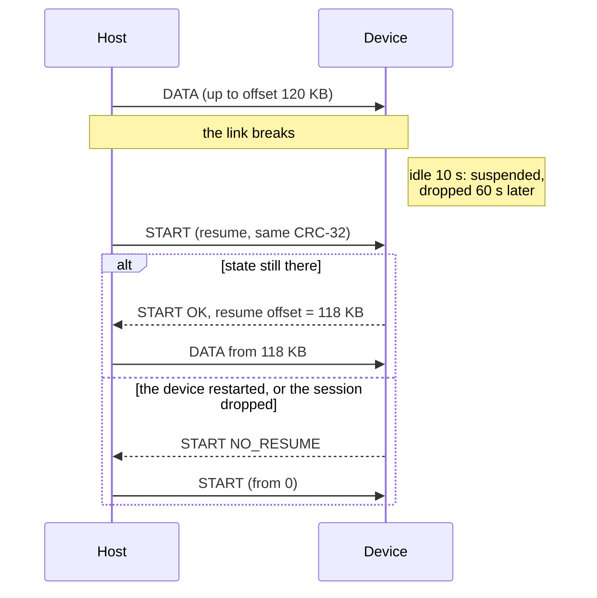

### The device's session

The normal path:

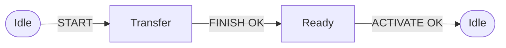

All of it:

| State | What happens | Next state |
|---|---|---|
| Idle | `START` for an image backend, `begin()` done | Transfer |
| Idle | `START` for a pass-through backend | Pass-through |
| Transfer | `DATA` and `ACK` | Transfer |
| Transfer | no frame for `idle_ms` | Suspended |
| Suspended | `START` with resume, or `DATA` from the owner | Transfer |
| Suspended | `resume_ms` passes (the backend is aborted) | Idle |
| Suspended | another peer's `START` for another image (the backend is aborted) | a new session |
| Transfer, Suspended | `FINISH`, with the CRC and the backend's checks OK | Ready |
| Transfer, Suspended | `FINISH` answered `PENDING` | Transfer |
| Transfer, Suspended | `BAD_STREAM`, a failed check or a backend error | Idle |
| Transfer, Suspended, Ready | the owner's `ABORT` | Idle |
| Transfer, Suspended, Ready | the owner's new `START`, not a retry or a resume of this image (the backend is aborted) | a new session |
| Ready | `START` with resume for the same image | Ready |
| Ready | `ACTIVATE` OK (the backend restarts after its delay) | Idle |
| Ready | `resume_ms` passes without `ACTIVATE` (the backend is aborted) | Idle |
| Pass-through | the owner's `ABORT`, `idle_ms`, or the backend ends it | Idle |
| Pass-through | the owner's `START` for another of this device's boards | a new session |

Ownership: the peer that started the session owns it. A `START` with the resume flag for the
same image takes an image session over from any peer; any other frame for it from another peer
gets `BUSY`, and so does another image's `START` until the session is suspended. A pass-through
session has one owner to its end; another peer gets `BUSY` until then. `INFO` and `STATUS` are
answered to anyone. `STATUS`'s state byte: 0 idle, 1 transfer, 2 suspended, 3 ready, 4
pass-through.

### The host's client

The normal path; without activate, `FINISH` OK goes straight to Done:

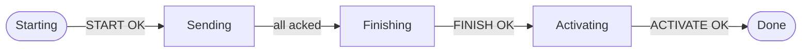

All of it:

| State | What happens | Next state |
|---|---|---|
| Starting | `START` OK: sends from its resume offset | Sending |
| Starting | `NO_RESUME`: `START` again from 0 | Starting |
| Sending | `DATA` while in flight is below the window; on `GAP` or RTO, from the acked offset | Sending |
| Sending | all of it acked | Finishing |
| Finishing | `PENDING`: `FINISH` again | Finishing |
| Finishing | `FINISH` OK, with activate | Activating |
| Finishing | `FINISH` OK, without activate | Done |
| Activating | `ACTIVATE` OK | Done |
| Any of these four | an error, no answer after `tries`, or `stall_ms` without progress | Failed |
| Any of these four, or Failed after `TIMEOUT` | `resume()` | Starting |

After a lost link the application calls `dfukit_client_resume()` on the new one, in any state
from `Starting` to `Activating`; the device answers from where it is.

## Board IDs: selector and acceptance in one

A board ID is a 32-bit number. A backend registers for one (a backend for several is registered
once per ID, as copies); `START` names one.
The ID selects the backend, and an ID that no backend registered is refused before anything is
touched. The images themselves are not changed.

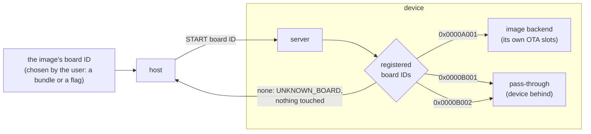

- dfukit only matches. You decide which ID an image is for, and must make sure the host sends the
  right one.
- The project assigns the numbers (from a table, or a hash of a board's name).
- `INFO` lists them, so a host can warn before it uploads.

## Backends

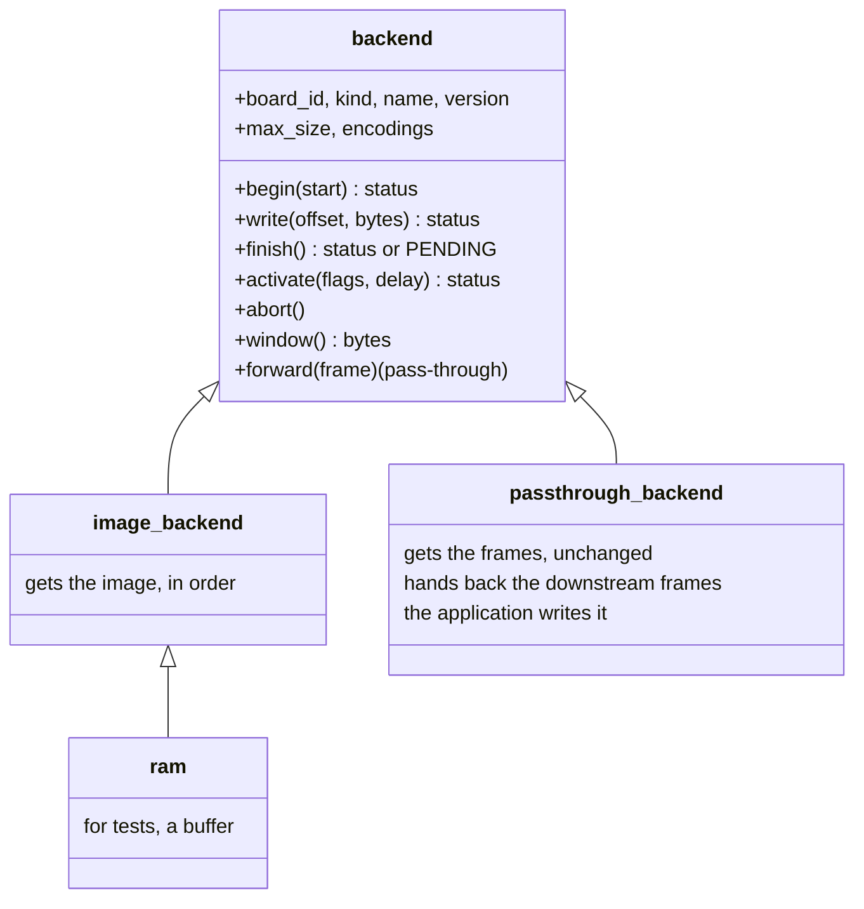

- ram: takes the image into a buffer; for tests, and for a device that handles the image itself.
- An application writes its own for an OTA slot or a bootloader's slot.
- Signatures stay with the backends: the CRC-32 only catches accidents. A backend that writes a
  device's only slot has overwritten the old image by the time the new one is checked; the device
  then waits for a good image.

### Pass-through backends

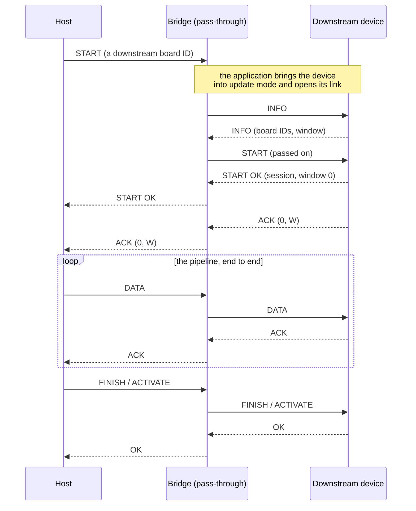

- The bridge forwards and does not read the session: the window, the progress and the checks
  are all the downstream device's. Only the `START` that opens the session, a `START` for another
  of its own boards and the owner's `ABORT` mean something to the bridge. It also notes `ACTIVATE`'s
  session and its OK, to answer a resend once the session is over.
- The session ends with the owner's `ABORT` (a client sends one when it fails, unless the link
  is gone), after `idle_ms` without a frame either way, or when the backend calls
  `dfukit_server_passthrough_end()`: only the backend knows its downstream device, and what it
  counts as done. Resume works from the owner's address; from a new one the host gets `BUSY`
  until the session is idle, then starts over. A resume of the image just activated is answered
  by the bridge, like a device's own: nothing reaches the device behind it again.
- The window is the downstream device's: the bridge announces what it announces, so the
  slowest buffer bounds the whole path. The bridge's own queue towards it must hold one window.
- The application decides what the backend does: how to reach the downstream device, how to put
  it into update mode, how long to wait for its `INFO`.

## The client, in C and from Python

- The client is driven like the server: frames in (`feed`), frames out (a send callback),
  time in (`poll`). It reads the stream from a callback (a file, flash), so the C client never
  needs the whole image in RAM. Python's `begin()` does: it takes the image as bytes.
- The Python package is thin: bindings to the C client and server, and the ram backend and
  pass-through. The C client holds the sender's logic; the caller provides the link and the clock.

## Code layout

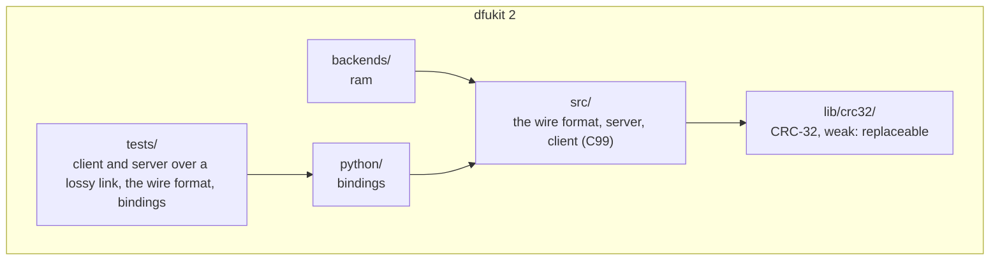

## Tests

The tests are in Python, on the shipped C code through its bindings (`tests/README.md`):

- A server and a client through a simulated link: a normal update, the refusals, the window,
  frames dropped, duplicated and delayed, resume, slow backends, two boards, a pass-through. The
  image must arrive whole, with a bounded number of resends.
- The frames, byte for byte, against bytes written out by hand.

```bash
cmake -S . -B build && cmake --build build && ctest --test-dir build --no-tests=error
pip install .   # the Python package, with the C library built in
```

## Examples

### A bridge with a device behind it

A bridge device updates itself and a device behind it. The host reaches the bridge over whatever
link the bridge offers; the bridge reaches the device over a serial link.

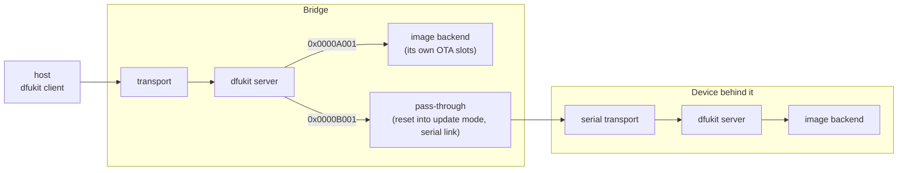

- The bridge registers its own board ID for its image backend, and the device's for its
  pass-through.
- On `START` for the device, the pass-through brings the device into update mode (for example a
  pin held while it resets it), then carries the session over the serial link.
- The device checks and writes the image itself.

## Open points

- Pass-through backends: how long to wait for the downstream device after bringing it into
  update mode is up to the backend; the host's resends of `START` cover the time it takes.
